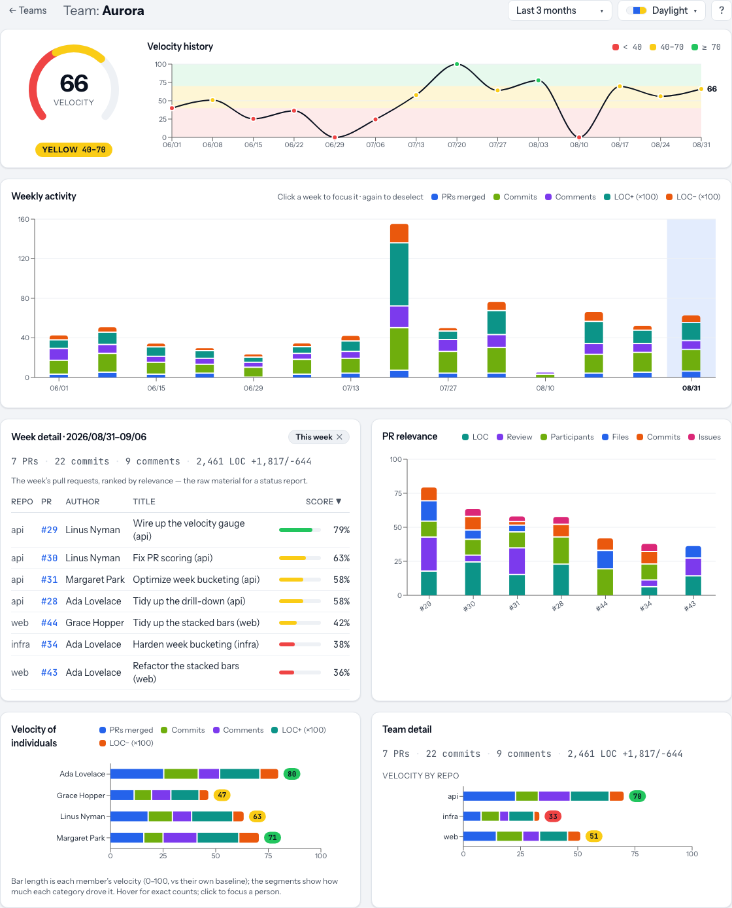

# TeamVelocity

A **local-first, backend-free** analytics tool for a software team's GitHub activity. A CLI puller
fetches + aggregates data into JSON files; a Vite/React SPA reads those files and renders weekly
**velocity** trends and a Team → Week → Person → Repo drill-down, plus a ranked list of the week's
most meaningful PRs for status reports.

> It describes **contribution shape**, not individual worth. There is no server, no database, and
> nothing is deployed — it runs on your machine.

See [`docs/prd.md`](docs/prd.md) for the full specification.

---



## Requirements

- [**Bun**](https://bun.sh) (the runtime **and** package manager — never use npm/yarn/pnpm).
- A GitHub Personal Access Token with `repo` + `read:org` scope (only needed for a real pull).

## Install

```bash
bun install
bunx playwright install chromium   # only needed to run the e2e suite
```

## Configure

1. **Teams & members** — copy the example config and edit it:

   ```bash
   cp teamvelocity.config.example.json teamvelocity.config.json
   ```

   ```jsonc
   {
     "teams": [
       {
         "id": "jdt",                    // stable slug used in data paths + URLs
         "name": "JDT",
         "sprintStartsOn": "Wed",        // week boundary: Mon..Sun (default Mon)
         "sprintStartHour": 0,           // hour the boundary flips (default 0)
         "members": [
           { "name": "Jeff", "github": "jeffhandle" },
           { "name": "Jack", "github": "https://github.com/jackhandle" }
         ],
         "repos": ["acme/backend", "acme/web"],   // OPTIONAL — needed for private repos
         "thresholds": { "red": 40, "green": 70 } // OPTIONAL — velocity color bands
       }
     ]
   }
   ```

   `github` may be a bare handle or a full profile URL. Repo scope is hybrid: the GitHub connector
   auto-discovers repos from members' activity **and** always includes the explicit `repos` list.
   Config is validated with Zod — an invalid file aborts the pull with a clear message.

2. **Token** — copy the example env file and add your token:

   ```bash
   cp .env.example .env
   # edit .env → GITHUB_TOKEN=ghp_...
   ```

   The token lives **only** in `.env` (git-ignored). It is never written into `public/data/`,
   never imported by the SPA, and never logged. Under Bun, `.env` is loaded automatically.

## Weekly workflow

```bash
bun run pull     # fetch + aggregate → writes public/data/<teamId>/*.json
bun run dev      # open the local app, then explore
```

"Fresh data" == re-run `bun run pull`, then refresh the browser tab. The app itself never calls
GitHub and never sees the token.

- **No token yet?** `bun run pull` (or `bun run pull --dry-run`) runs the whole pipeline over
  bundled fixtures and writes valid JSON — so you can try the flow without a token.
- Useful flags: `--team <id>`, `--weeks <N>` (how far back to reach, default 26), `--since` /
  `--until`, `--data-dir <path>`, `--verbose`.

### Incremental pulls

Pulls are incremental. Each GitHub handle's normalized PRs, commits and review activity are
cached under `.cache/pull/<source>/<handle>.json` (git-ignored, disposable), together with the
window of time that cache covers. A pull fetches only the gap between that coverage and what you
asked for, plus two days of overlap so anything that changed right at the boundary is still
picked up. The first pull backfills; a pull the next day asks GitHub for about three days.

History **accumulates**. `--weeks 26` means "reach at least 26 weeks back", so a later pull with a
smaller `--weeks` never truncates what you already have, and the dashboard's range grows with
every pull. Run with `--verbose` to see the exact window requested per handle, and the GraphQL
rate-limit points each pull spent.

| Flag | Default | When you need it |
| --- | --- | --- |
| `--full` | off | Re-fetch everything and replace the cache. The only way to drop PRs deleted upstream, or to re-apply a change in how data is normalized. Widens to the coverage you already have, so it never shrinks history. |
| `--no-cache` | off | Read and write nothing. One-off exploratory pull; the result covers only the requested window and does not accumulate. |
| `--overlap-days <N>` | `2` | How far back before the covered edge to re-fetch. |
| `--cache-dir <path>` | `.cache/pull` | Where the cache lives. |

Deleting `.cache/` is always safe: the next pull backfills it. A cache file that is corrupt or
written by an older version is reported and re-fetched rather than failing the pull.

## Scripts

| Script | What it does |
| --- | --- |
| `bun run dev` | Start the Vite dev server (reads the committed sample dataset). |
| `bun run pull` | Fetch + aggregate GitHub data → `public/data/` (dry-run over fixtures with no token). |
| `bun run generate:sample` | Regenerate the committed sample dataset in `public/data/sample*`. |
| `bun run build` | Type-check + build the static SPA to `dist/`. |
| `bun run preview` | Preview the production build. |
| `bun run lint` | ESLint (must be clean — 0 errors, 0 warnings). |
| `bun run typecheck` | `tsc --noEmit` (strict). |
| `bun run test` | Vitest unit + integration (timezone-pinned to Europe/Prague). |
| `bun run test:e2e` | Playwright e2e over the committed sample dataset. |

## Architecture

Two halves share one **source-agnostic aggregation library**:

```
teamvelocity.config.json  .env (GITHUB_TOKEN)
            │                    │
            ▼                    ▼
  CLI puller (cli/) ── SourceConnector plugins (GitHub via Octokit)
        fetch + normalize → shared/aggregate (pure metrics) → writer → public/data/*.json
                                                                          │  (static JSON)
                                                                          ▼
  React SPA (src/) — NO token, NO GitHub calls — fetch('/data/…') → dashboards + drill-down
```

**Invariants** (see `docs/prd.md §3` / `CLAUDE.md`):

1. The SPA (`src/`) never imports `cli/`, Octokit, the config, or the token, and makes no GitHub
   request — enforced by an ESLint `no-restricted-imports` boundary. Its only data source is
   `fetch` of files under `/data/`.
2. Connectors only **fetch + normalize** — no metric math lives in a connector.
3. Velocity, PR-score, and week bucketing are **pure functions** in `shared/aggregate/` (the
   TDD core), identical across sources.
4. Everything in `public/data/` is **Zod-validated** — the writer validates before writing, the
   loader validates after fetching. Fail loud on drift.

### Metrics

- **Velocity (0–100)** — a team-rhythm indicator, not a grade. Each week's log-dampened weighted
  signal is normalized against the team's own rolling median/MAD, so a typical week lands near 50,
  a stronger week climbs toward 100, and a quiet/PTO week falls toward 0 automatically. Weights and
  color thresholds are configurable per team (`docs/prd.md §7.1`).
- **PR relevance (0–100)** — per-PR signals (LOC, review activity, participants, files, commits,
  linked issues), log-dampened and min-max normalized within the week's PR set, then weighted
  (`docs/prd.md §7.2`).

## Project structure

```
src/       React SPA (never imports cli/ or the token)
cli/       data puller: config, connectors/ (GitHub), writer, pull, sample generator
shared/    pure source-agnostic aggregation + Zod schema (imported by cli and tests)
public/data/  generated (git-ignored) + a committed sample/ (+ sample-solo/) fixture set
.cache/pull/  per-handle incremental-pull cache (git-ignored, disposable)
e2e/       Playwright specs over the sample dataset
docs/      the PRD
```

## Adding a source (future)

Bitbucket/JIRA are out of v1 scope, but the seam exists: implement `SourceConnector`
(`cli/connectors/types.ts`), register it in `cli/connectors/index.ts`, and give members the
matching handle in the config. No UI or metric changes are needed — aggregation and scoring are
source-agnostic.

## Testing

- **Unit/integration (Vitest):** pure logic is TDD'd (week bucketing incl. DST, velocity, PR-score,
  config + JSON validation); the GitHub connector runs against recorded fixtures (no live network);
  the writer emits Zod-valid JSON. Date tests run under `TZ=Europe/Prague`.
- **E2E (Playwright):** team-select (+ single-team auto-skip), the full drill-down and deselect,
  date-range changes, a PR row linking to GitHub, and the "no data yet" state — all over the
  committed sample dataset, zero network, no token.
```

Run everything: `bun run lint && bun run typecheck && bun run test && bun run test:e2e`.
