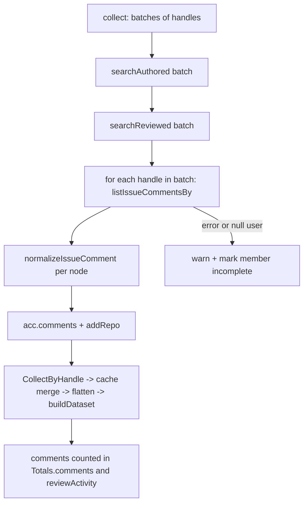
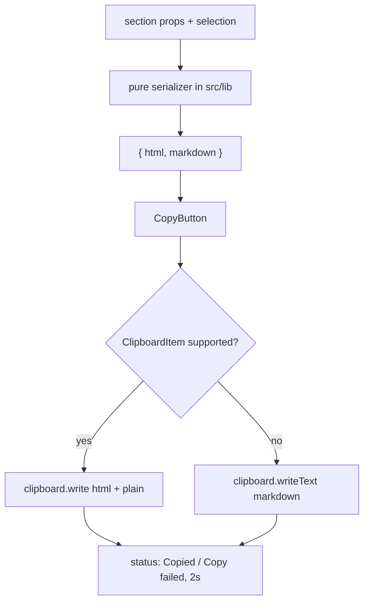

# Week Layout, Copy-as-Rich-Text, and Comment Collection - Plan

## Goal Capsule

- **Objective:** A team lead can read a focused week's PR list without scrolling sideways, paste any drill-down section into Claude (or a doc) with its links intact, and see each member's discussion comments on any public repo credited as contribution.
- **Authority:** `CLAUDE.md` architectural invariants > this plan's Product Contract > Key Technical Decisions > unit Approach text. `docs/prd.md` is updated to match where this plan changes behavior it describes.
- **Execution profile:** Three independent tracks (layout, copy, comment collection) that can land as separate commits on one `feature/` branch. Pure aggregation and connector logic are TDD; UI gets component tests plus e2e right after.
- **Stop conditions:** Stop and ask if GitHub's `User.issueComments` connection turns out not to return other users' comments on public repos for a token-holder, or if including comments in the team/member review term breaks a velocity invariant test in a way that suggests the model, not the test, is wrong.
- **Who finishes:** `ce-work` implements; the user runs one full `bun run pull` against live GitHub afterwards to refill the cache.

---

## Product Contract

### Summary

Stack the Week detail and PR relevance cards full width, one after the other, above the side-by-side individuals/person row. Add a Copy button to the Week detail, Velocity of individuals, and Person detail headers that writes HTML (with links) plus a Markdown fallback to the clipboard. Extend the GitHub puller to collect every issue/PR conversation comment a member writes on any repo the token can see, and count those comments in the Comments category and in velocity.

### Problem Frame

Week detail shares a two-column grid with PR relevance at `xl` widths, so its PR table is squeezed into half the page and scrolls horizontally — the section meant to be "the raw material for a status report" is the hardest one to read. Getting that material out of the app today means hand-copying rows and losing links, which defeats pasting it into Claude for a write-up.

On the data side, a member's only recorded discussion activity is one `review_summary` per reviewed PR. Comments they leave on issues and PRs — especially in upstream or neighbouring public repos the team does not own — are value they created but are invisible to every metric.

### Requirements

**Week layout**

- R1. When a week is focused, Week detail and PR relevance each occupy the full content width, Week detail first, PR relevance directly below it.
- R2. Velocity of individuals and Person detail keep their current side-by-side arrangement at `xl` widths, below PR relevance.
- R3. At a 1280px-wide viewport the Week detail PR table fits without horizontal scrolling.

**Copy as rich text**

- R4. Week detail, Velocity of individuals, and Person detail each have a Copy button at the top-right of the card header. PR relevance does not (it is a chart).
- R5. Copy places both an HTML version (headings, tables or lists, working links to PRs, commits, comments, and repos) and a Markdown plain-text version on the clipboard, so a paste into Claude, a doc, or Slack keeps links.
- R6. The copied content reflects what the section shows for the current selection: the focused week, and for Person detail the selected member or team scope and the selected repo when one is chosen.
- R7. The button confirms success ("Copied") or failure ("Copy failed") inline for about two seconds, without a modal or browser dialog.

**Comment collection**

- R8. The puller collects every issue and PR conversation comment each member authored within the pull window, on any repository visible to the token (public repos at minimum), including repos the team does not own.
- R9. Each comment is recorded individually at its own creation time and links to the comment itself; a comment on a PR records that PR's number.
- R10. Inline code-review comments are not counted individually; a review keeps counting as one entry per reviewed PR, as today.
- R11. Comments on a member's own PRs count the same as comments elsewhere.
- R12. Collected comments count in the Comments category and in team, member, and per-repo velocity.
- R13. A repo where a member only commented appears in their per-repo breakdown like any other repo.
- R14. Existing caches are discarded once so the next pull refetches full history including comments.

### Key Decisions

- **Every comment counts individually at its creation time** — chosen over one entry per thread participated in (cheaper, coarser). Governs R9, R11. (session-settled: user-approved — chosen over per-thread entries: finer-grained and true to when the work happened)
- **Comment-only repos appear in the repo breakdown** — chosen over hiding them from the repo list while still counting the comments. Governs R13. (session-settled: user-approved — chosen over hiding: the comments are real contribution in that repo)
- **Copy on Week detail, Velocity of individuals, Person detail** — chosen over also copying the PR relevance chart. Governs R4. (session-settled: user-approved — chosen over copying charts: a chart has no useful text form)
- **One-time full refetch** — chosen over leaving old cached windows without comments. Governs R14. (session-settled: user-approved — chosen over a partial backfill: the cache is disposable and correctness beats one slower pull)

### Success Criteria

- Pasting a copied Week detail into Claude yields a readable table whose PR titles are clickable links.
- After a full pull, a member who comments upstream shows a non-zero Comments count and a comment-only repo in their Person detail for that week.

### Scope Boundaries

- Inline review comments, commit comments, and GitHub Discussions comments are not collected.
- Comments are not filtered by repository visibility; whatever the token can see is collected (see KTD5).
- No change to PR relevance scoring — a PR's own `issueCommentsCount` already feeds it.

#### Deferred to Follow-Up Work

- Copying the PR table in the user's current column sort order (the copy uses relevance order; see KTD3).
- Showing an issue number on issue (non-PR) comment rows — the data contract has only `prNumber`.
- A copy action for the Range overview card.

---

## Planning Contract

### Key Technical Decisions

- KTD1. **Two layout blocks instead of one grid.** Render Week detail and PR relevance in a plain vertical stack, then a separate `xl:grid-cols-2` grid holding Velocity of individuals and Person detail. Simpler than `col-span-2` overrides inside one grid and keeps the person row's alignment independent.
- KTD2. **Serialize from data, not the DOM.** Each copyable section gets a pure serializer in `src/lib/` that turns the section's props (`WeekDetail`, `Scope`, selection) into `{ html, markdown }`. Scraping the rendered DOM would drag in Recharts SVG, sort arrows, and hidden screen-reader text, and could not be unit-tested without a browser.
- KTD3. **Week detail copies in relevance order.** `PrTable` keeps its sort state internally; lifting it just to mirror the sort in the copy is deferred. The serializer sorts by score descending, matching the table's default.
- KTD4. **Clipboard via `navigator.clipboard.write` with a `ClipboardItem` holding `text/html` and `text/plain`.** Fall back to `writeText(markdown)` when `ClipboardItem` is unavailable. `bun run dev` serves on localhost, which is a secure context, so the async Clipboard API is available. One shared `CopyButton` component (built on the existing `Button`) owns the call and the transient status.
- KTD5. **Per-member `User.issueComments`, newest-updated first.** Add a `listIssueCommentsBy(handle, since, until)` method to the `GitHubClient` seam. It pages `user(login) { issueComments(first: 100, orderBy: {field: UPDATED_AT, direction: DESC}) }` and stops once a page's oldest `updatedAt` is before `since`. It keeps comments whose `createdAt` falls in `[since, until)`. A comment created in the window always has `updatedAt >= since`, so the `updated:`-window coverage model from the incremental-pull design still holds. The connection is per user, so it is not batched; cost is about one point per 100 comments, and incremental pulls usually need one page per member. No visibility filter: GitHub only returns comments the token may see, which satisfies "public repos at minimum".
- KTD6. **Comments reuse the existing `Comment` entity with `kind: "issue"`.** `prNumber` is set from `pullRequest.number` when present, `url` is the comment's own URL, and the repo comes from `repository`. No schema change is needed in `shared/schema/data.ts` or `shared/types.ts`. Cache and flatten already key comments by URL, and an issue-comment URL (`#issuecomment-…`) never collides with a `review_summary` URL (the PR URL).
- KTD7. **All comments feed the team and member review term.** Today team and member velocity take `reviewActivity` only from `review`/`review_summary` comments, while per-repo velocity and the members velocity stack already use all comments. R12 requires `issue` comments to count too, so the team and member signals switch to the total comment count. This brings the three paths in line. It shifts velocity baselines once; the full refetch (R14) happens at the same moment, so the history is recomputed consistently.
- KTD8. **Failures mark the member incomplete, never fatal.** A failed or errored comment fetch, or a `user` that resolves to null (renamed/deleted handle), warns and marks that member's result `complete: false`, mirroring the search failure path in `cli/connectors/github/connector.ts`.
- KTD9. **Invalidate caches by bumping `CACHE_VERSION` from 2 to 3, but keep the old date range as a fetch hint.** `loadHandleCache` treats a different version as a miss and returns an empty cache. On its own that would shrink history: `runPull` widens its fetch target only from stored coverage, so the next pull would fetch only `--weeks`, and the dataset would drop every older week. For example, the `jdt` data goes back to 2026-03-10, but a default 26-week pull reaches only about 2026-05-21. So when a stale-version file is readable, the loader also returns its coverage as a separate hint. `runPull` widens the team target with that hint, but plans fetch windows from the empty cache. Passing the old range in as real coverage would be wrong, because the planner would treat it as already fetched and skip the refetch. This mirrors what `--full` already guarantees: it "can never shrink accumulated history".

### High-Level Technical Design

Comment collection slots into the existing per-batch loop as a third, per-member fetch:

Copy flow, the same shape for all three sections:

### Risks and Mitigations

| Risk | Mitigation |
|---|---|
| The one-time full refetch is expensive for prolific commenters (one point per 100 comments, back to the range start). | Paging stops at `since` (KTD5). The pull logs the points spent; the README warns about the first pull (U7). |
| A failed comment fetch would cache a window as covered without its comments. | KTD8 marks the member incomplete, so the window is retried on the next pull. |
| Velocity values shift for weeks with plain comments (KTD7), which could read as a regression. | The change lands with the refetch, so all history is recomputed together. The PRD records the new review term (U6). |
| `User.issueComments` ordering or visibility differs from the docs for non-viewer users. | U4's tests pin the paging contract. The live smoke pull is the check, and the Goal Capsule stop condition covers it. |
| The Clipboard API is unavailable when the app is served over a non-localhost HTTP origin. | `CopyButton` shows "Copy failed" instead of throwing. The app is localhost-only by design (`CLAUDE.md`: no deployment). |

### Sources and Research

- GitHub GraphQL reference: `User.issueComments` (`IssueCommentConnection`, `orderBy: IssueCommentOrder` with field `UPDATED_AT` only); `IssueComment` exposes `createdAt`, `updatedAt`, `url`, `repository`, `issue`, `pullRequest` (null when not on a PR).
- `docs/superpowers/specs/2026-09-15-incremental-pull-design.md` — the coverage-interval model that KTD5 must not break.
- `shared/aggregate/dataset.ts` (comment loop and velocity series) — where KTD7 lands.
- `cli/cache/store.ts` `loadHandleCache` — version-mismatch-is-a-miss behavior relied on by KTD9.

---

## Implementation Units

### U1. Full-width Week detail and PR relevance

- **Goal:** Stack Week detail and PR relevance full width, then the members/person row as a two-column grid.
- **Requirements:** R1, R2, R3
- **Dependencies:** none
- **Files:** `src/routes/Dashboard.tsx`, `src/components/tables/PrTable.tsx`, `e2e/dashboard.spec.ts`
- **Approach:** Per KTD1, split the single `grid gap-4 xl:grid-cols-2` wrapper into a vertical stack holding the first two cards, then a grid for the other two. Keep `gap-4` spacing between all four. Add test hooks: `data-testid="weekly-activity"` on the Weekly activity card, and `data-testid="pr-table-scroll"` on `PrTable`'s `overflow-x-auto` wrapper. The wrapper is the element that scrolls; the existing `pr-table` id sits on the `<table>`.
- **Patterns to follow:** Existing Tailwind spacing tokens in `Dashboard.tsx`; no arbitrary values.
- **Test scenarios:**
  - At 1280×800 with the latest week focused, `week-detail` and `pr-relevance` have the same width as the weekly-activity card, and `pr-relevance` sits below `week-detail`.
  - At 1280×800, `pr-table-scroll`'s `scrollWidth` is not greater than its `clientWidth`.
  - At 1440×900 with a member selected, `members-section` and `person-detail` are side by side (same top, different left).
- **Verification:** e2e passes; a visual check in `bun run dev` shows no horizontal scrollbar on Week detail.

### U2. Section serializers for copy

- **Goal:** Pure functions turning Week detail, Velocity of individuals, and Person detail data into `{ html, markdown }`.
- **Requirements:** R5, R6
- **Dependencies:** none
- **Files:** `src/lib/copy-export.ts`, `src/lib/copy-export.test.ts`
- **Approach:**
  1. Week detail: heading with the week label, a totals line, then a table of PRs (repo, linked `#number`, linked title, author, state, score) in score-descending order (KTD3).
  2. Velocity of individuals: heading, then a table of members (name, velocity, band, PRs, commits, comments, LOC +/−).
  3. Person detail: heading naming the member or "Team", totals, a per-repo table with repo links. When a repo is selected, add sections for that repo's PRs, commits, and comments with their links.
  4. HTML escapes all text and attribute values; Markdown escapes `|` and `[`/`]` in titles.
- **Execution note:** Implement test-first.
- **Patterns to follow:** Formatting helpers in `src/lib/format.ts` (`formatScore`, `formatVelocity`, `formatLoc`); selection shapes in `src/lib/selectors.ts`.
- **Test scenarios:**
  - Week detail with three PRs of scores 40, 90, 70: both outputs list them 90, 70, 40, and each title is an `<a href>` (HTML) / `[title](url)` (Markdown) pointing at the PR URL.
  - A PR title containing `<script>` and `|` is escaped in HTML and does not break the Markdown table.
  - Week with zero PRs: outputs contain the heading and a "No pull requests" line, not an empty table.
  - Person detail for a member with a repo selected: output names the member, links the repo URL, and includes that repo's comment rows linked to comment URLs.
  - Person detail with no member selected: heading says team scope.
  - Members table: every member row appears with velocity formatted the same way the UI formats it.
- **Verification:** Unit tests green under `TZ=Europe/Prague`.

### U3. CopyButton and section wiring

- **Goal:** A reusable Copy button in the three card headers.
- **Requirements:** R4, R5, R7
- **Dependencies:** U2
- **Files:** `src/components/ui/CopyButton.tsx`, `src/components/ui/CopyButton.test.tsx`, `src/components/sections/WeekPrSection.tsx`, `src/components/sections/MembersSection.tsx`, `src/components/sections/PersonDetailSection.tsx`, `e2e/copy.spec.ts`
- **Approach:**
  1. `CopyButton` takes a lazy `getContent: () => { html, markdown }`, so serialization runs only on click. Clipboard behavior follows KTD4.
  2. Status resets after about two seconds, and the timer is cleared on unmount.
  3. In each section header, place the button at the right end next to the existing deselect chip or legend; the header is already `justify-between`.
  4. Give each button a `data-testid` (`copy-week`, `copy-members`, `copy-person`) and an `aria-label` naming the section.
- **Patterns to follow:** `src/components/ui/Button.tsx` (`ghost` or `outline` variant); `DeselectChip` for header-chip sizing.
- **Test scenarios:**
  - Click with a mocked `navigator.clipboard.write` and global `ClipboardItem`: `write` receives one item with `text/html` and `text/plain` blobs, and the button shows "Copied".
  - With `ClipboardItem` undefined: `writeText` is called with the Markdown, and the button shows "Copied".
  - `write` rejects: the button shows "Copy failed" and nothing throws.
  - After the status timeout, the label returns to "Copy".
  - E2E (Chromium, clipboard permissions granted, `?data=/data/sample-solo`): clicking `copy-week` and then reading the clipboard's `text/html` returns a table containing an `href` to a PR URL from the sample week.
  - E2E: after selecting a member, `copy-members` and `copy-person` each put HTML with at least one link on the clipboard.
  - E2E: the `pr-relevance` card contains no Copy button.
- **Verification:** Component and e2e tests pass; pasting into Claude in a real browser keeps the links.

### U4. Fetch member issue comments from GitHub

- **Goal:** A client method that returns a member's issue/PR conversation comments within a window.
- **Requirements:** R8, R9, R10
- **Dependencies:** none
- **Files:** `cli/connectors/github/types.ts`, `cli/connectors/github/octokit-client.ts`, `cli/connectors/github/octokit-client.test.ts`, `cli/connectors/github/fake-client.ts`
- **Approach:**
  1. Add the `GhIssueCommentNode` raw shape: `url`, `createdAt`, `updatedAt`, `repository`, and `pullRequest { number } | null`.
  2. Add `listIssueCommentsBy` to `GitHubClient` with paging and stop rules per KTD5. It returns `SearchOutcome`-like `{ nodes, truncated: false }`, or a distinct "user not found" signal when `user` is null.
  3. Account rate-limit cost the same way `searchAll` does, and reuse the `fetchPage`-style single retry for a data-less 200.
  4. Fake client: extend `GitHubFixtures` with an optional `commented: Record<handle, GhIssueCommentNode[]>`. The fake applies the same window filter.
- **Execution note:** Implement test-first against the injected `GraphqlFn` seam; no live network.
- **Patterns to follow:** `createGitHubClientFromGraphql` and its tests in `cli/connectors/github/octokit-client.test.ts`.
- **Test scenarios:**
  - Two pages where page 2's last node has `updatedAt` before `since`: exactly two GraphQL calls are made, and no third page is requested.
  - A node with `createdAt` before `since` but `updatedAt` inside the window (an edited old comment) is excluded.
  - A node created at or after `until` is excluded; one created exactly at `since` is included.
  - `user` is null: the method reports not-found rather than an empty success.
  - A page response with no `data` retries once, then throws a message naming the handle.
  - `rateLimit.cost` from each page is added to `usage().cost`.
- **Verification:** Client unit tests green; `bunx tsc --noEmit` clean.

### U5. Normalize and credit comments in the connector

- **Goal:** Each member's collected result includes their issue comments and the repos those comments touched.
- **Requirements:** R8, R9, R11, R13
- **Dependencies:** U4
- **Files:** `cli/connectors/github/normalize.ts`, `cli/connectors/github/connector.ts`, `cli/connectors/github/connector.test.ts`, `cli/connectors/github/__fixtures__/github-fixtures.json`
- **Approach:**
  1. Add `normalizeIssueComment(node, handle)` producing a `Comment` per KTD6.
  2. In `collect`, after the authored and reviewed searches for each batch, call `listIssueCommentsBy` for each handle in the batch.
  3. Push the normalized comments and `addRepo` each comment's repo.
  4. Failures and not-found follow KTD8.
  5. Extend the summary log line to report issue comments separately from reviews.
- **Patterns to follow:** `normalizeReviewComment`, `searchReviewed`, and `markIncomplete` in the same files.
- **Test scenarios:**
  - A fixture member with two comments on a PR in a repo they never authored or reviewed in: the result has two `issue` comments with `prNumber` set, and that repo is in `repos`.
  - A comment on an issue (null `pullRequest`): `prNumber` is undefined and `url` is the comment URL.
  - A comment on the member's own authored PR is kept (R11).
  - The comment fetch throws for one member: that member is `complete: false`, other members stay `complete: true`, and the authored PRs are still returned.
  - A null user: warns, marks the member incomplete, and does not throw.
  - A dry-run (`bun run pull --dry-run`) over the fixtures still completes.
- **Verification:** Connector tests green; dry-run pull writes a dataset whose sample member has `issue` comments.

### U6. Count comments in team and member velocity

- **Goal:** Issue comments feed the review term of team and member velocity, not only the Comments category.
- **Requirements:** R12
- **Dependencies:** none (pure; can land before U5)
- **Files:** `shared/aggregate/dataset.ts`, `shared/aggregate/dataset.test.ts`, `src/components/ScoreHelp.tsx`, `docs/prd.md`
- **Approach:** Per KTD7, the comment loop credits every comment kind to the team and member review counters. Relabel the in-app formula in `ScoreHelp.tsx` from `ln(1+reviews)` to `ln(1+comments)`. Update the PRD velocity formula text (`wReview·log1p(reviews + reviewComments)`) and the §5/§6 comment description to say all collected comments count, and describe the new issue-comment source.
- **Execution note:** Write the failing dataset test first.
- **Patterns to follow:** Existing comment-loop tests in `shared/aggregate/dataset.test.ts`.
- **Test scenarios:**
  - A week with one `issue` comment by a member and nothing else: member and team velocity raw signal are greater than zero, and `totals.comments` is 1.
  - A week with one `review_summary` and one `issue` comment: the review term counts 2, matching `totals.comments`.
  - An `issue` comment in a repo with no other activity: that repo appears in the member's per-repo breakdown with `comments: 1`.
- **Verification:** All `shared/aggregate` tests green; existing velocity invariant tests unchanged or updated with a stated reason.

### U7. Invalidate caches and refresh sample data

- **Goal:** The next real pull refetches everything, and committed fixtures exercise the new comment kind.
- **Requirements:** R14
- **Dependencies:** U5, U6
- **Files:** `shared/schema/cache.ts`, `shared/schema/cache.test.ts`, `cli/cache/store.ts`, `cli/cache/store.test.ts`, `cli/pull.ts`, `cli/pull.test.ts`, `cli/generate-sample.ts`, `public/data/sample/`, `public/data/sample-solo/`, `README.md`
- **Approach:**
  1. Bump `CACHE_VERSION`, and in the loader and `runPull` add the stale-coverage widening hint, both per KTD9.
  2. Make the sample generator emit some `issue` comments, including at least one in a repo the member has no PRs in, so the e2e data covers R13.
  3. Regenerate the committed samples.
  4. Add a README note that the first pull after upgrading refetches back to the earliest previously covered week, which costs more rate-limit points.
- **Patterns to follow:** Existing cache version test; current generator RNG structure.
- **Test scenarios:**
  - A cache file written with version 2 loads as an empty cache with a warning, not an error, and exposes its old coverage as the widening hint.
  - Pull with `requested` starting 2026-05-21 and a v2 cache whose coverage starts 2026-03-10: the planned fetch window starts at 2026-03-10, not 2026-05-21, and the rebuilt dataset still begins at 2026-03-10.
  - A corrupt or unparseable cache file gives no hint, so behavior is unchanged.
  - The regenerated sample passes the SPA loader's Zod validation (existing loader tests).
- **Verification:** `bun run test` and `bun run test:e2e` green over the regenerated samples.

---

## Verification Contract

| Gate | Command | Applies to |
|---|---|---|
| Lint, zero warnings | `bun run lint` | every unit |
| Types | `bunx tsc --noEmit` | every unit |
| Unit and integration | `TZ=Europe/Prague bun run test` | U2–U7 |
| E2E | `bun run test:e2e` | U1, U3, U7 |
| Dry-run pipeline | `bun run pull --dry-run` | U5, U7 |
| Live smoke (user) | `bun run pull`, then open the dashboard | after merge |

E2E data for the real dataset needs `?data=` because `.env` sets `VITE_DATA_DIR=/data`.

## Definition of Done

- R1–R14 hold, each proven by a named test above or by the live smoke for R8.
- No test is red, lint is clean with zero warnings, and `tsc` is clean.
- `src/` still imports nothing from `cli/` and makes no GitHub request (invariant #1).
- `docs/prd.md` describes the issue-comment source and the updated review term.
- No dead or experimental code from abandoned approaches remains in the diff.
